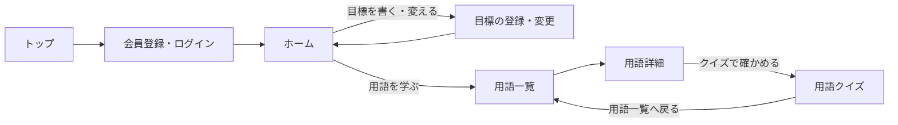
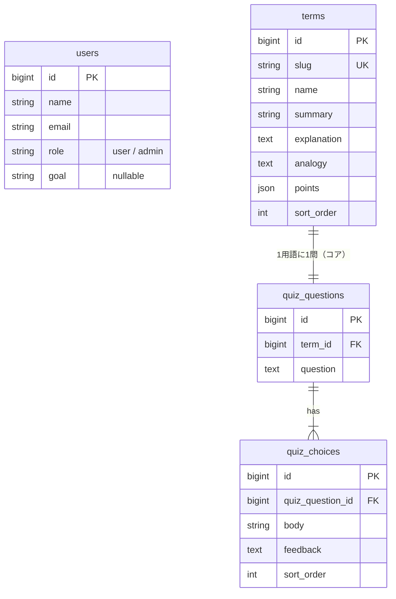

# 仕様書 2: 画面とデータの設計

> 仕様書 1（要件定義）のコア C1〜C10 を作るための設計。拡張は扱わない。

## 前提（いまの learn-app）

- Laravel 13 ＋ Livewire 4 スターターキット（Fortify、Flux UI）。会員登録・ログイン・プロフィール設定の画面はすでにある
- 画面は Livewire の1ファイルコンポーネント（`resources/views/pages/` の下）で作る。スターターキットの書き方に合わせる
- ログイン後の行き先は `/dashboard`（`config/fortify.php` の `home`）。この画面を「ホーム」として作り替える

 

## スターターキットから変えること

| 変更 | 理由 |
|-|-|
| メール認証をやめる（`User` の `MustVerifyEmail` を外し、ルートの `verified` を外す。Fortify の `emailVerification` を無効にする） | コアではメールを使わない。中高年が登録で迷わないように手順を減らす |
| 2段階認証・パスキーの設定画面はそのまま残す（メニューには出さない） | 消すと変更が大きい。使わなくても動作に影響しない |
| 画面の文言を日本語にする（`lang/ja`、`APP_LOCALE=ja`） | コア C9 |

 

## 画面一覧

| # | 画面 | URL | ルート名 | ログイン | 内容 |
|:-:|-|-|-|:-:|-|
| S1 | トップ | `/` | `home` | 不要 | アプリの紹介、「はじめる（会員登録）」「ログイン」。ログイン済みならホームへ移動 |
| S2 | 会員登録・ログイン | `/register` `/login` | （スターターキット） | 不要 | 名前、メール、パスワード |
| S3 | ホーム | `/dashboard` | `dashboard` | 必要 | 上部に「わたしの目標」（未登録なら登録を促すカード）。下に「用語を学ぶ」への入口 |
| S4 | 目標の登録・変更 | `/goal` | `goal.edit` | 必要 | 目標を1行で入力して保存。保存後はホームへ戻る |
| S5 | 用語一覧 | `/terms` | `terms.index` | 必要 | 用語を `sort_order` 順にカードで並べる（用語名とひとこと説明） |
| S6 | 用語詳細 | `/terms/{term:slug}` | `terms.show` | 必要 | やさしい説明、身近なたとえ、ポイント（最大3つ）、「クイズで確かめる」ボタン |
| S7 | 用語クイズ | `/terms/{term:slug}/quiz` | `terms.quiz` | 必要 | 問題と選択肢。選ぶと同じ画面にその選択肢の「考え方のポイント」を出す。「ほかの選択肢も見る」「用語一覧へ戻る」 |

### 画面の流れ

### クイズ画面（S7）の決まりごと

- 「正解」「不正解」「〇」「×」は表示しない（仕様書 1 のストーリー5）
- 選んだ選択肢の `feedback`（考え方のポイント）を表示する。選び直してよい
- 回答は保存しない（進み具合の記録は拡張 E4）。画面の中の状態（Livewire のプロパティ）だけで扱う

 

## データ設計

### ER 図

### users（既存テーブルに追加）

| カラム | 型 | 内容 |
|-|-|-|
| `role` | string(20)、初期値 `user` | `user`（利用者）/ `admin`（運営者）。`App\Enums\Role` で扱う |
| `goal` | string(100)、nullable | わたしの目標。未登録は null |

- `role` は `$fillable` に入れない（会員登録で書き換えられないように）

### terms（用語）

| カラム | 型 | 内容 |
|-|-|-|
| `id` | bigint | |
| `slug` | string(50)、unique | URL に使う英字（例：`nisa`、`diversification`） |
| `name` | string(50) | 用語名（例：分散投資） |
| `summary` | string(100) | 一覧に出すひとこと説明 |
| `explanation` | text | やさしい説明（目安3行） |
| `analogy` | text | 身近なたとえ |
| `points` | json | ポイントの配列（最大3つ）。`array` にキャストする |
| `sort_order` | unsigned int | 一覧の並び順 |
| `timestamps` | | |

### quiz_questions（クイズの問題）

| カラム | 型 | 内容 |
|-|-|-|
| `id` | bigint | |
| `term_id` | foreignId、unique、cascadeOnDelete | どの用語のクイズか（コアは1用語1問） |
| `question` | text | 問題文 |
| `timestamps` | | |

- 拡張で1用語に複数問にするときは `term_id` の unique を外す

### quiz_choices（選択肢）

| カラム | 型 | 内容 |
|-|-|-|
| `id` | bigint | |
| `quiz_question_id` | foreignId、cascadeOnDelete | |
| `body` | string(100) | 選択肢の文 |
| `feedback` | text | 選んだときに出す「考え方のポイント」 |
| `sort_order` | unsigned int | 表示順（A、B、C は表示時に順番から付ける） |
| `timestamps` | | |

- 「正解」を持つカラム（`is_correct`）は作らない。どの選択肢にも、その考え方への解説を書く

 

## モデルとリレーション

| モデル | リレーション |
|-|-|
| `Term` | `hasOne(QuizQuestion::class)` / ルートキーは `slug` |
| `QuizQuestion` | `belongsTo(Term::class)` / `hasMany(QuizChoice::class)->orderBy('sort_order')` |
| `QuizChoice` | `belongsTo(QuizQuestion::class)` |
| `User` | `goal` を `$fillable` に追加 |

 

## 目標の入力ルール（S4）

- 任意。空で保存すると目標を消す（null にする）
- 100文字まで
- 例をプレースホルダーに出す：「老後のために、少しずつお金を育てたい」

 

## 初期データ（シーダー）

| シーダー | 内容 |
|-|-|
| `AdminSeeder` | 運営者ユーザー1人（`role = admin`）。メールとパスワードは `.env` から読む |
| `TermSeeder` | 最初の5語と、それぞれのクイズ（問題1つ、選択肢3つ） |

- 5語の文章（説明、たとえ、ポイント、問題、選択肢、考え方のポイント）は、別ファイル `doc/spec/03_terms_content.md` に書いてから `TermSeeder` に写す
- 文章は仕様書 1 の「コンテンツの方針」に従う

 

## 見た目

- スライドと同じ配色：クリーム色（背景）、オレンジ（ボタン・強調）、紺（見出し）、水色（カード）
- フォント：見出しは Zen Maru Gothic、本文は Noto Sans JP
- 本文の文字は 18px 以上、ボタンは指で押しやすい大きさ（高さ 48px 以上）
- スマートフォンの縦画面を基本にする

 

## Pest テスト（コア C10）

| # | テスト | 確認すること |
|:-:|-|-|
| T1 | 未ログイン | ホーム、目標、用語一覧・詳細・クイズはログイン画面へリダイレクトされる |
| T2 | 用語一覧 | 用語が `sort_order` 順に表示される |
| T3 | 用語詳細 | 説明、たとえ、ポイントが表示される。存在しない slug は 404 |
| T4 | クイズ | 選択肢を選ぶと、その選択肢の `feedback` が表示される。「正解」「不正解」の文字は出ない |
| T5 | 目標の保存 | 保存するとホームに表示される。100文字を超えるとエラー。空で保存すると消える |
| T6 | 会員登録 | 登録したユーザーの `role` は `user`。登録フォームから `role` を送っても変わらない |
